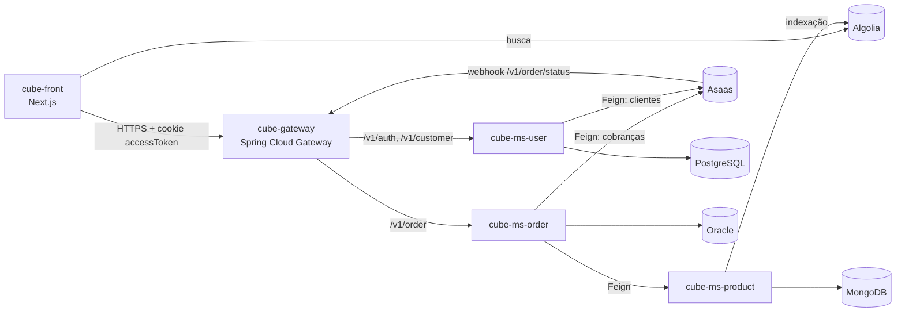

# cube-ms-eureka

Servidor de descoberta de serviços (**Netflix Eureka Server**) do **Cube**. Todos os microsserviços e o gateway se registram aqui, e o gateway usa o registro para rotear as requisições (`lb://NOME-DO-SERVICO`).

## Ecossistema Cube



Todos os serviços e o gateway se registram no **cube-ms-eureka**.

| Repositório | Papel | Stack |
| --- | --- | --- |
| [cube-front](https://github.com/MatheysJ/cube-front) | Loja (interface web) | Next.js, Chakra UI, Algolia |
| [cube-gateway](https://github.com/MatheysJ/cube-gateway) | API Gateway e autenticação JWT | Spring Cloud Gateway |
| **cube-ms-eureka** (este repositório) | Descoberta de serviços | Netflix Eureka Server |
| [cube-ms-user](https://github.com/MatheysJ/cube-ms-user) | Usuários e login | Spring Boot, PostgreSQL |
| [cube-ms-product](https://github.com/MatheysJ/cube-ms-product) | Catálogo de produtos | Spring Boot, MongoDB, Algolia |
| [cube-ms-order](https://github.com/MatheysJ/cube-ms-order) | Pedidos e pagamentos | Spring Boot, Oracle, Asaas |
| [cube-admin](https://github.com/MatheysJ/cube-admin) | Painel administrativo (em planejamento) | - |

## O que ele faz

- Mantém o registro dos serviços ativos (`CUBE-MS-USER`, `CUBE-MS-ORDER`, `CUBE-MS-PRODUCT`, `CUBE-GATEWAY`).
- Expõe o dashboard do Eureka na raiz (`/`) e a API de registro em `/eureka/`.
- Roda em modo *standalone*: não se registra em si mesmo (`register-with-eureka: false`) nem busca registro de outros servidores (`fetch-registry: false`).

## Tecnologias

- Java 21
- Spring Boot 3.4.5
- Spring Cloud 2024.0.0 (`spring-cloud-starter-netflix-eureka-server`)
- Docker (build multi-stage com Amazon Corretto) e deploy no Fly.io

## Variáveis de ambiente

| Variável | Obrigatória | Descrição |
| --- | --- | --- |
| `EUREKA_DEFAULT_ZONE` | Sim | URL de serviço do Eureka. Local: `http://localhost:8761/eureka/`. |
| `PORT` | Não | Porta HTTP. Padrão: `8761`. |
| `HOSTNAME` | Não | Hostname da instância. Padrão: `localhost`. |

## Como executar

Pré-requisito: JDK 21+.

```bash
export EUREKA_DEFAULT_ZONE="http://localhost:8761/eureka/"

./mvnw spring-boot:run   # no Windows: mvnw.cmd spring-boot:run
```

Dashboard em <http://localhost:8761>.

### Docker

```bash
docker build -t cube-ms-eureka .
docker run -p 8761:8761 \
  -e PORT=8761 \
  -e EUREKA_DEFAULT_ZONE="http://localhost:8761/eureka/" \
  cube-ms-eureka
```

### Deploy no Fly.io

O `fly.toml` usa o app `cube-ms-eureka` (região `gru`, 1 vCPU e 1 GB) com `internal_port = 8080`. Como a aplicação escuta em `PORT` (padrão `8761`), defina `PORT=8080` no ambiente do Fly para as portas coincidirem.

```bash
fly secrets set PORT=8080 EUREKA_DEFAULT_ZONE="https://<seu-app>.fly.dev/eureka/"
fly deploy
```

## Como os outros serviços se conectam

Cada serviço aponta para este servidor pela variável `EUREKA_URL` (gateway, user, product e order). Serviços que rodam fora do ambiente do Eureka, como numa máquina local atrás de um túnel, informam o hostname público em `EUREKA_INSTANCE` para que o gateway consiga alcançá-los.

## Estrutura

```
src/main/java/com/cube/eureka/EurekaApplication.java   # @EnableEurekaServer
src/main/resources/application.yml
Dockerfile
fly.toml
```

## Autor

Desenvolvido por [@MatheysJ](https://github.com/MatheysJ).
